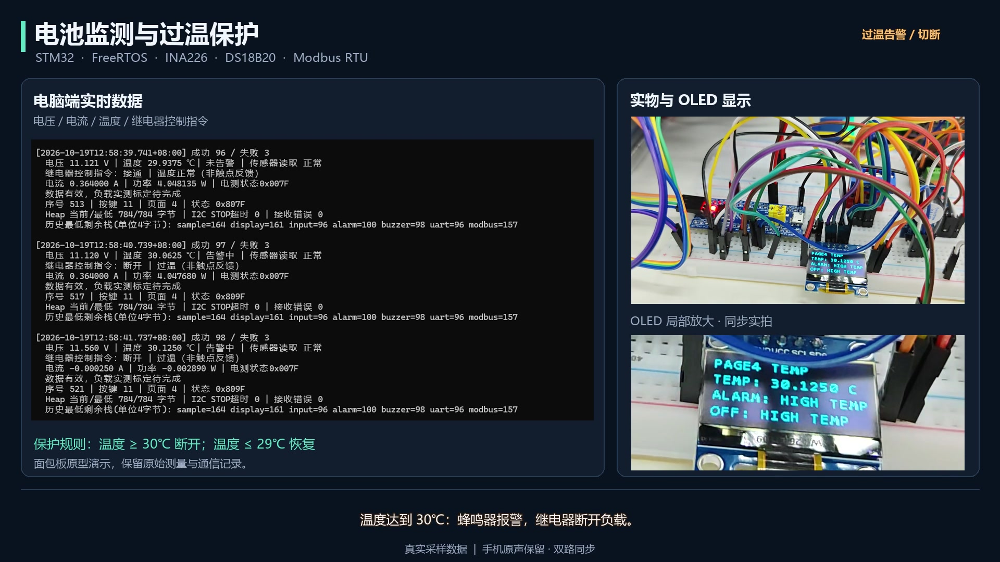

# STM32 + FreeRTOS 电量监测与过温断载演示

基于 STM32F103C8T6、INA226、DS18B20、OLED 和 RS485 的实物项目。系统读取电压、电流和温度，通过 Modbus RTU 上传电脑，并在温度达到 30°C 时用继电器断开电阻负载，降到 29°C 或以下后自动恢复。

已完成电压、电流、温度采集，以及过温断载、降温恢复的实物闭环演示。本仓库包含当前验证版本的代码、接线说明与演示材料。



**[观看带原声与中文字幕的演示视频](docs/media/demo.mp4)** · [字幕](docs/media/demo.zh-CN.srt) · [实测 CSV](docs/data/demo-session.csv)

## 已实现

- INA226 电压、电流与功率读取；DS18B20 温度读取；OLED 四页显示与按键切页。
- FreeRTOS 七任务调度，队列传递数据，共用 I²C 总线由互斥锁保护。
- 超温报警与蜂鸣器提示；低电平触发继电器断载，含 30/29°C 回差。
- 温度等待、故障或数据超过 1500 ms 未更新时，继电器输出断开指令。
- RS485 / Modbus RTU 从站，以及 Python 只读轮询、终端展示和 CSV 记录。

未实现 SOC 估算、实时图形界面、电流/电压阈值断载、完整充放电管理及硬件看门狗。继电器状态字段是软件指令，没有触点反馈。

## 复现入口

1. 阅读 [硬件与接线](docs/hardware.md)，断电完成接线。
2. 按 [构建与运行](docs/build-and-run.md) 用 Keil 构建、下载固件。
3. 安装 Python 依赖，运行主站（串口名按实际设备选择）：

```powershell
python -m venv .venv
.\.venv\Scripts\python.exe -m pip install -r host/requirements.txt
.\.venv\Scripts\python.exe host/modbus_master.py --list-ports
.\.venv\Scripts\python.exe host/modbus_master.py --port COM6
```

串口：**115200 / 8E1，地址 1，FC03，起始寄存器 0，数量 36**。同时只用一个主站打开该串口。输出日志默认写入本地 `logs/`，不纳入版本管理。

## 资料索引

| 目录或文件 | 内容 |
| --- | --- |
| [firmware](firmware/bms-lite.uvprojx) | 当前实物验证固件、Keil 工程、FreeRTOS 必要源码与 RTE 配置 |
| [host](host/README.md) | Python 只读 Modbus 主站及固定版本依赖 |
| [接线说明](docs/hardware.md) | 引脚、供电、继电器与负载回路 |
| [软件结构](docs/architecture.md) | 任务、数据流、保护策略 |
| [寄存器表](docs/modbus.md) | 36 寄存器与有效性标志 |
| [实测结果](docs/validation.md) | 温度保护闭环演示与实测数据 |
| [软件检查](docs/software-checks.md) | 打包后的本地构建和软件测试结果 |
| [演示材料](docs/demo.md) | 视频、同步方式与原声说明 |
| [离线数据图](docs/media/demo-trace.png) | 由演示 CSV 生成的离线分析图，不是实时界面 |
| [上传说明](docs/publishing.md) | 上传 GitHub 前的文件与许可检查 |

## 许可

**原创代码暂未指定开源许可证，发布前再决定。** 仓库公开不等于自动授予自由使用、修改或再分发原创代码的许可。FreeRTOS、ST 等第三方内容仍适用其各自许可，见 [第三方说明](THIRD_PARTY_NOTICES.md)；未对它们重新授权。
