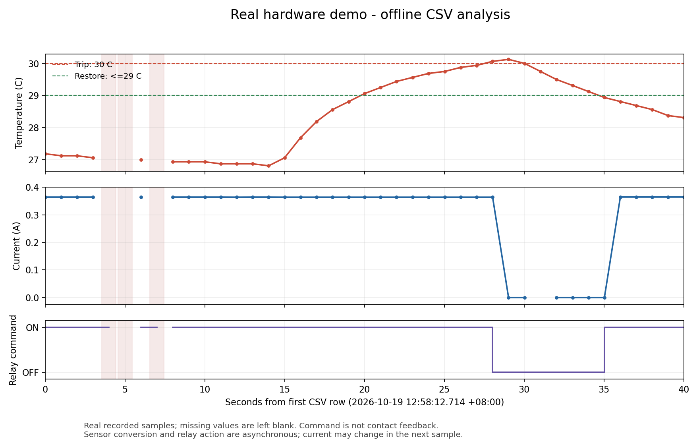

# 实测结果

2026-10-19 已完成真实电阻负载的温度保护演示。下列结果来自实物记录。

## 温度保护闭环

[demo-session.csv](data/demo-session.csv) 包含本次演示 12:58:12～12:58:52 的主站记录。

| 阶段 | 温度与动作 | 电流表现 |
| --- | --- | --- |
| 常温运行 | 继电器接通 | 约 0.364 A |
| 过温断载 | 12:58:40.739，30.0625°C，切换为断开指令 | 下一次读取约 −0.00025 A，接近零 |
| 降温恢复 | 12:58:47.742，28.9375°C，恢复接通指令 | 下一次读取约 0.3645 A |

系统采用 30°C 断开、29°C 或以下恢复的回差控制。视频同时展示电脑端数据、OLED 温度与保护状态，并保留现场蜂鸣器声音。

传感器转换与继电器动作异步进行，因此决策当次的电流可能仍来自动作前的转换，负载变化可在下一次读取中观察。CSV 中的空值保持原样。

该图由随包的 CSV 离线生成，展示温度、电流与继电器指令随时间变化。继电器字段表示软件控制指令；实物动作通过现场演示核对。

## 软件与资源检查

实测记录显示剩余堆约 784 字节，I²C STOP 超时计数为 0。整理后的工程编译与软件测试结果见 [软件检查](software-checks.md)。
